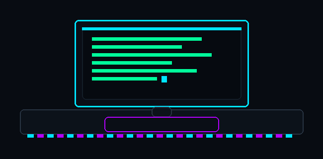

<div align="center">
  
</div>

<div align="center">
  
</div>

<h1 align="center">⚡ Shubham Raj ⚡</h1>

<p align="center">
  <b>DevOps • MLOps • Cloud Infrastructure • Systems Engineering</b>
</p>

<p align="center">
  <a href="https://komarev.com/ghpvc/?username=ShubhamRaz&label=Profile%20Views&color=00e5ff&style=for-the-badge&logo=eye">
    
  </a>
  <a href="https://github.com/ShubhamRaz">
    
  </a>
  <a href="https://www.linkedin.com/in/shubhamraz/">
    
  </a>
  <a href="mailto:pksrofficial@gmail.com">
    
  </a>
  <a href="https://instagram.com/subamraz">
    
  </a>
</p>

<div align="center">
  
</div>

---

### 👨‍💻 About Me

```yaml
name: Shubham Raj
role: DevOps & MLOps Engineer
location: India
focus_areas:
  - Cloud Infrastructure & Orchestration (AWS, Kubernetes, Docker)
  - Infrastructure as Code & Automation (Terraform, GitHub Actions)
  - End-to-End MLOps Pipelines (Model Training, Serving, Monitoring)
  - Observability & Reliability (Prometheus, Grafana, ELK)
philosophy: "Automate once, monitor continuously, sleep soundly."
```

- 🔭 **Currently Building**: Highly scalable microservice deployments, CI/CD automation pipelines, and robust production ML architectures.
- ⚙️ **Core Expertise**: Containerization, GitOps workflows, automated testing & releases, and resilient cloud architectures.
- 🧠 **MLOps Focus**: Streamlining data pipelines, automated model retraining, versioning with DVC/MLflow, and real-time inference monitoring.
- 💬 **Ask me about**: Docker, Kubernetes, Linux internals, AWS cloud services, and pipeline optimization.
- ⚡ **Fun Fact**: If a task has to be performed manually more than twice, it gets a script or an automation pipeline.

---

### 🛠️ Tech Stack & Tooling

<div align="center">

#### ☁️ Cloud, Containers & Orchestration
<p align="center">
  
  
  
  
  
  
</p>

#### 🧠 Machine Learning & MLOps
<p align="center">
  
  
  
  
  
  
  
</p>

#### 🚀 CI/CD, Observability & Databases
<p align="center">
  
  
  
  
  
  
  
</p>

</div>

---

### 📊 Real-Time GitHub Analytics

<div align="center">
  
  
</div>

<br />

#### 📑 Profile & Commit Breakdown
<div align="center">
  
  
</div>

<div align="center">
  
</div>

---

<div align="center">
  <sub>Designed with ⚡ by <a href="https://github.com/ShubhamRaz"><b>Shubham Raj</b></a> • Always building & automating</sub>
</div>
